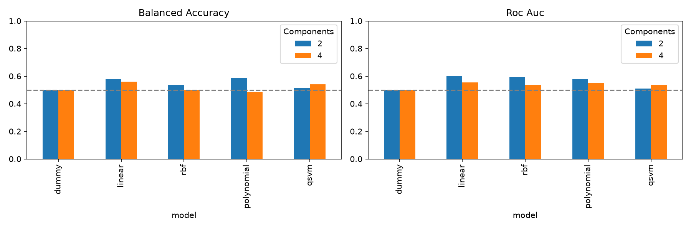
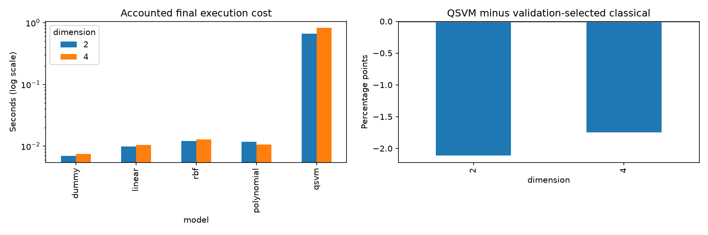
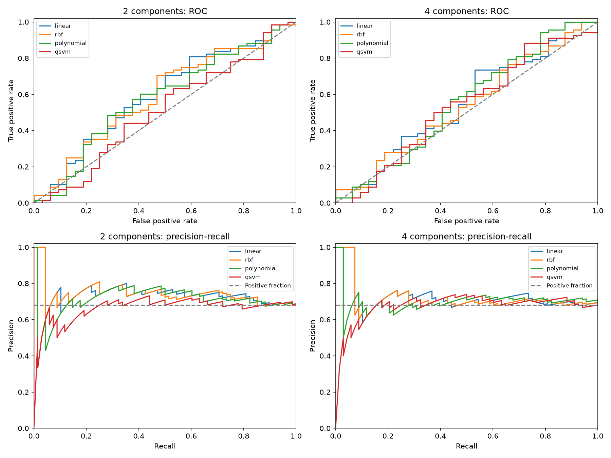

# Notebook 05: Comparison and analysis

## Purpose and scope
This stage consolidates the completed classical and QSVM experiments, verifies their saved evidence, and interprets predictive performance and measured computation costs. It trains no new models and changes no hyperparameters.

The executed notebook is `notebooks/05_comparison_analysis.ipynb`.

## Reproduce in VS Code
Open the project folder, select `.venv-stage4/Scripts/python.exe` as the notebook kernel and Run All. On another computer, install `requirements-stage4.txt` in a Python 3.12 environment first.

The notebook reads compact committed snapshots under `reports/stage5/evidence`, rather than requiring the large market dataset or rerunning the models. `manifest.json` records the original result paths and SHA-256 hashes. Snapshots freeze the analyzed run; new model runs require a new evidence set and explicit reanalysis rather than silently changing this report.

Local derived outputs are written to `results/stage5`. The executed notebook and selected charts are committed for review.

## Comparability
| Experiment | Inputs | Final development rows | Evaluation rows | Role |
|---|---|---:|---:|---|
| Stage 3 | 16 engineered features | 2,500 | 1,000 | Larger classical baseline |
| Stage 4 | 2 or 4 bounded PCA components | 280 | 100 | Matched classical/QSVM comparison |

Both stages use the same five stocks and source feature files, but differ in sample sizes and preprocessing. They must not be ranked together as if only the kernel changed. Stage 4's ten model configurations share identical evaluation keys and labels. Its 100 rows span only 20 market dates, with 68 UP and 32 DOWN/unchanged labels.

## Verification
- All notebook code cells executed without errors and passed schema validation.
- Every committed source snapshot matched its manifest hash.
- Stage 3 and Stage 4 metadata agree on original input hashes.
- Stock-date keys are unique, labels are binary, and row counts match the recorded partitions.
- Accuracy, balanced accuracy, precision, recall, F1, ROC-AUC and average precision were independently recomputed for all ten Stage 4 configurations: 70 values matched.
- This audit reuses the earlier stages' temporal and preprocessing checks; it does not establish source-price accuracy or eliminate selection bias.

## Main findings
The QSVMs beat the dummy's 50% balanced accuracy, but neither exceeds the classical comparator chosen by validation balanced accuracy. This comparison avoids selecting the comparator from evaluation outcomes.

| PCA components / qubits | Validation-selected classical model | Classical balanced accuracy | QSVM balanced accuracy | QSVM difference |
|---|---|---:|---:|---:|
| 2 | rbf | 53.77% | 51.65% | -2.11 percentage points |
| 4 | linear | 55.88% | 54.14% | -1.75 percentage points |

The all-UP dummy obtains 68% raw accuracy and 50% balanced accuracy. This illustrates why accuracy or positive-class F1 alone would be misleading on this sample. ROC curves, precision-recall curves, all pairwise classical/QSVM differences and per-ticker diagnostics are included in the notebook. Average precision is used as the PR summary; it is not trapezoidal PR-AUC.

## Computational accounting
Final execution cost is computed as preprocessing + model fit + prediction + explicit training/evaluation kernel construction for QSVM. Classical SVC includes its kernel calculations inside its fit/predict calls. This is a sum of recorded components, not a fresh end-to-end wall-clock measurement. It excludes loading, search and diagnostic checks. Shared preprocessing is allocated once per hypothetical model run.

| Qubits | Accounted QSVM seconds | Fraction spent constructing kernels |
|---|---:|---:|
| 2 | 0.6605 | 98.54% |
| 4 | 0.8286 | 98.84% |

Kernel construction dominates these simulator runs. Single-run subsecond timings are machine-specific and insufficient for reliable scaling or speedup conclusions. Reported kernel-array memory excludes the statevector cache and the rest of process memory. Logical circuit depth and two-qubit gate counts are not hardware-transpiled costs.

## Predictive diagnostics
The precision-recall reference level is the 68% positive fraction. Per-ticker results contain only 20 observations per ticker and are descriptive; they must not be used to select assets for improved reported results.

## Limitations
The evaluation period has already been inspected and is exploratory. No untouched confirmatory holdout, confidence intervals, hypothesis tests, profitability study or quantum advantage has been established. Observations are correlated across stocks and dates.

Five-stock selection and the full-history eligibility rule may create survivorship bias. The source price-adjustment policy remains unverified. Missing sessions can make targets span more than one trading session. Small validation samples make selected parameters unstable. Exact 2–4-qubit statevector simulation is classically tractable and does not model real-device errors.

## Milestone and remaining stages
This completes the comparison stage and the agreed approximate 70% implementation milestone: data preparation, features, classical baselines, training-only PCA/encoding, an initial QSVM, and a verified matched comparison. The percentage describes planned scope, not measured effort or scientific confidence.

Two main stages remain:
1. Prespecified scalability, circuit, shot and noise experiments. Optional hardware execution requires its own setup and authorization.
2. Time-aware statistical validation, robustness/source-data review and the final report and presentation.

These future stages should freeze their protocol before examining fresh evaluation results. Broader conclusions must wait for that evidence.
